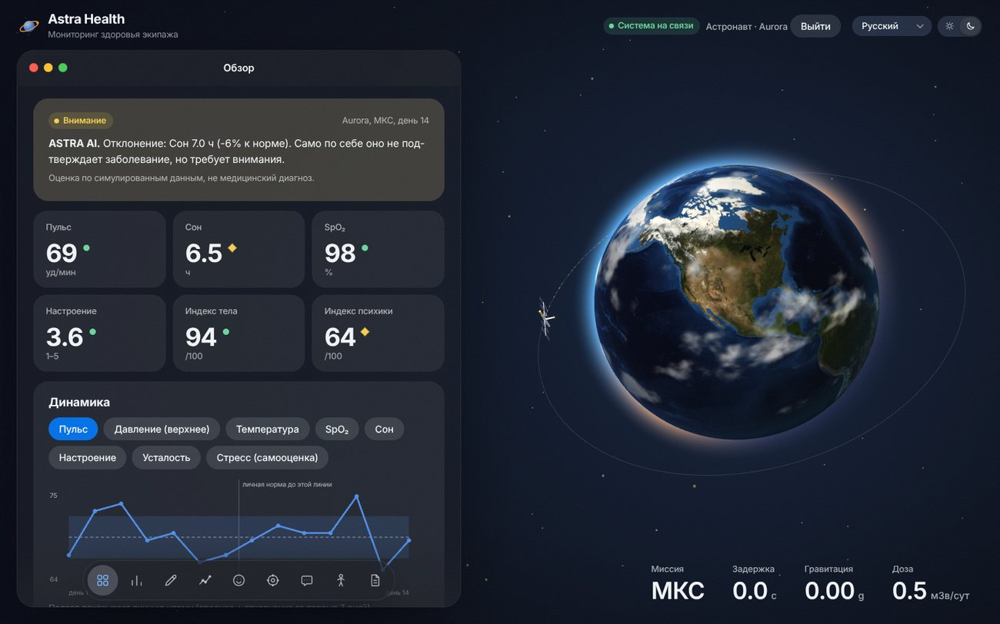
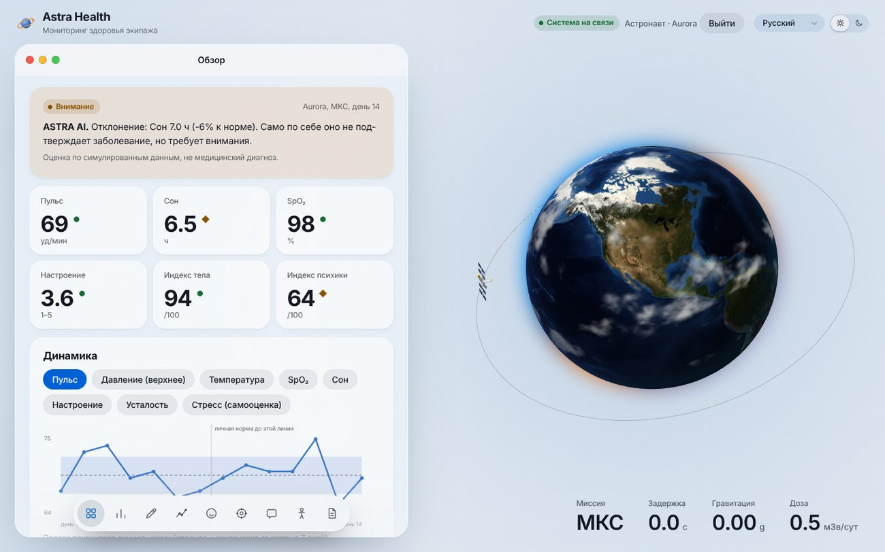
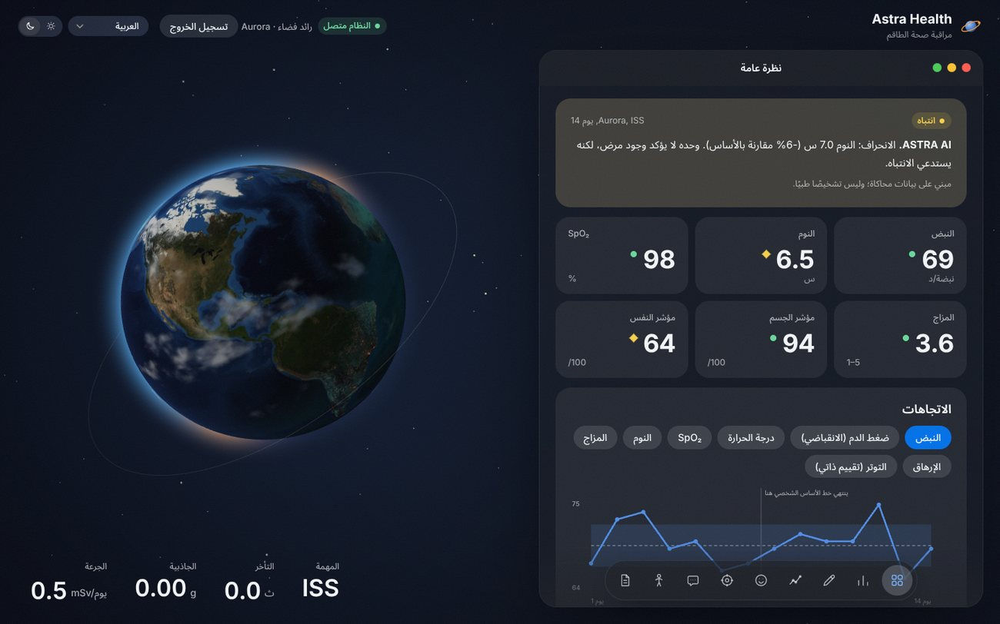
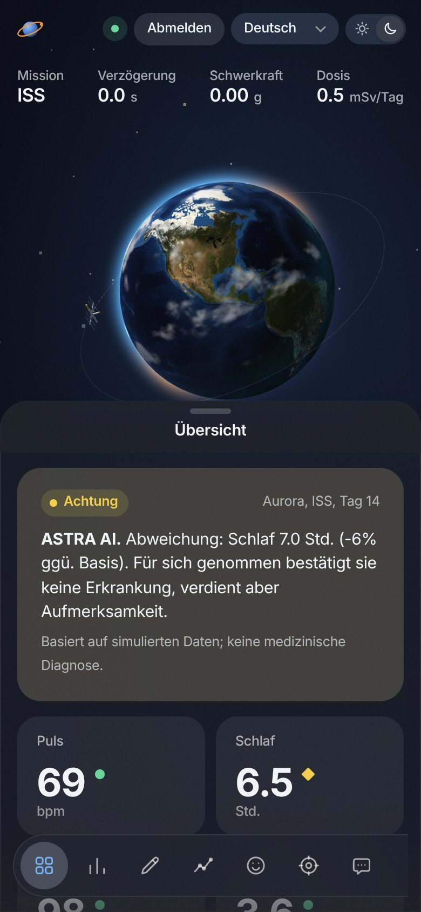

# Astra-health
project for NASA

# Astra Health

Демо-прототип мониторинга здоровья экипажа космической миссии: личная норма по первым 7 дням, прозрачный движок правил, психофизиологические тесты в духе NASA WinSCAT, 3D-сцена с Землёй, Луной и Марсом.

**Все данные синтетические. Это демонстрация, а не медицинский инструмент и не диагностика.**

| Тёмная тема | Светлая тема |
|---|---|
|  |  |

| Арабский (справа налево) | Телефон |
|---|---|
|  |  |

## Как открыть

Скачайте `index.html` и откройте в браузере. Сборка не нужна: это один файл с ванильным JavaScript.

Для 3D-сцены страница подгружает с CDN Three.js r128, шрифты Google Fonts и текстуры Земли (`three-globe` через jsDelivr), поэтому нужен интернет. Без текстур Земля рисуется процедурно.

Чтобы опубликовать как сайт: *Settings → Pages → Deploy from a branch → `main` / root*.

## Что внутри

- **Окно в стиле macOS/iOS** с «светофором» (красная выходит из аккаунта, жёлтая сворачивает окно, зелёная расширяет), матовые материалы, группированные карточки, док с увеличением.
- **Светлая и тёмная темы.** Выбор сохраняется, по умолчанию берётся тема системы. Сцена тоже меняется.
- **15 языков без ИИ:** русский, английский, немецкий, французский, испанский, португальский, итальянский, турецкий, украинский, казахский, китайский, японский, корейский, арабский (RTL), хинди. Язык выбирается по языку браузера.
- **Роли:** астронавт видит свой кабинет, командир видит весь экипаж, миссии и ИИ экипажа. Вход без пароля.
- **Три когнитивных теста:** «Конфликт сигналов», «Периферийный радар», «Контур жизнеобеспечения».

## Переводы

Строки интерфейса лежат в `i18n/`. Это текстовые файлы `номер|строка`; номера соответствуют `i18n/en.txt` (английский источник) и `i18n/ru.txt` (русский источник). В `index.html` словарь встроен готовым блоком (`const EN=…, BI=…`).

Заполнители `{0}`, `{1}`… и теги `<b>`, ` ` должны совпадать с оригиналом.

Переводы на 13 языков выполнены ИИ (Claude) и носителями не вычитывались, особенно это касается медицинских формулировок на казахском, хинди и турецком. Правки приветствуются.

## Дизайн-промпт

`ASTRA-DESIGN-PROMPT.md`: набор правил «чтобы интерфейс не выглядел сгенерированным ИИ» (запреты, токены цвета, шрифты, движение, 3D-сцена) со скриптом автопроверки и описанием трёх концепций оформления.

## Известные ограничения

- Скорость на слабых видеокартах не измерялась: матовый эффект перерисовывается поверх анимированной сцены (отключается настройкой системы «уменьшить прозрачность»).
- Десятичный разделитель везде точка.
- Лицензия не указана.
